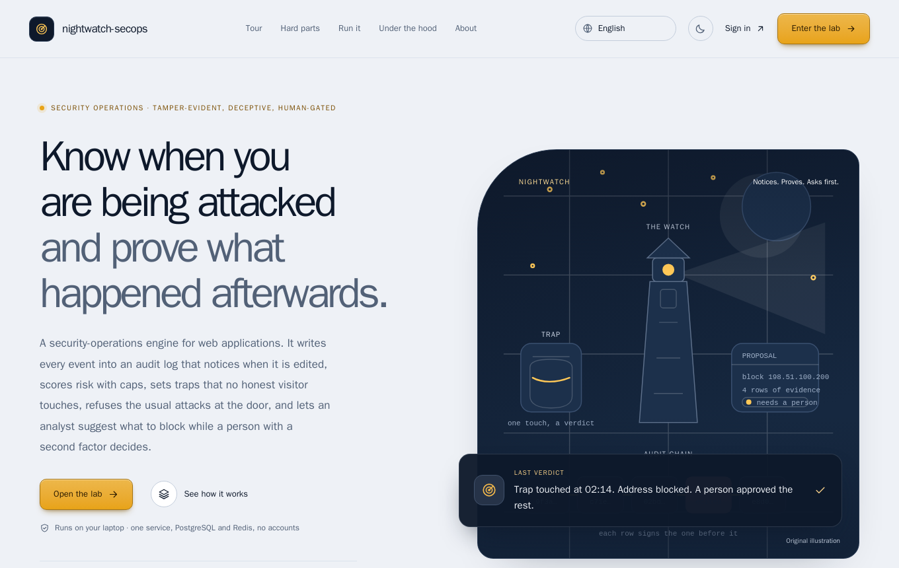
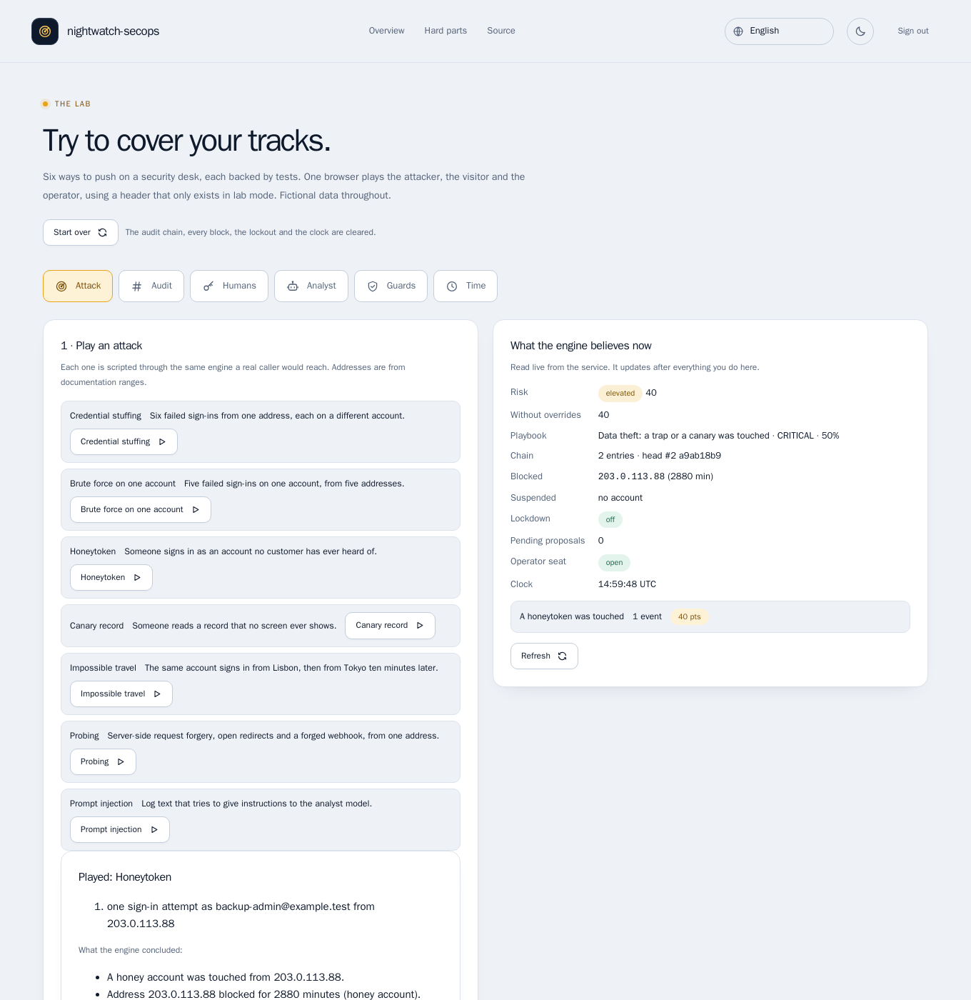
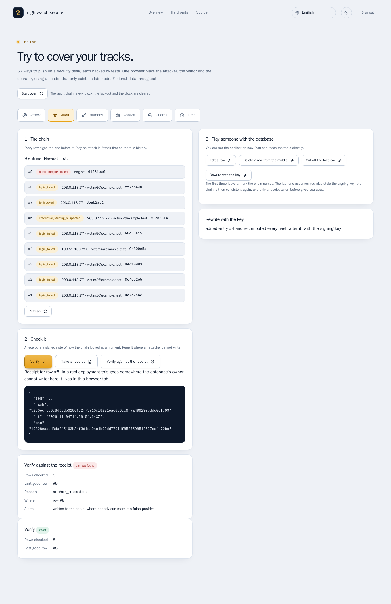
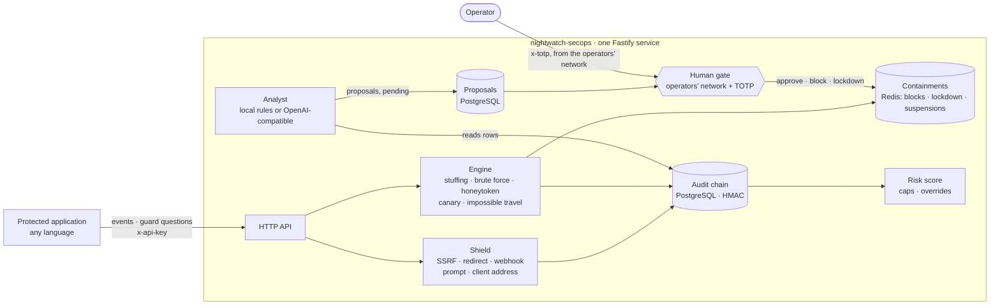
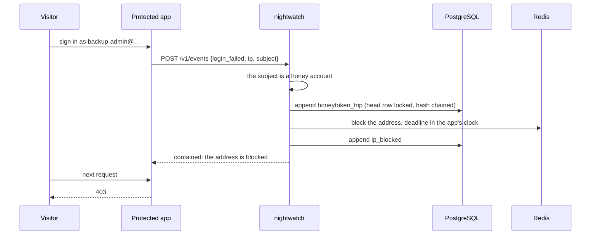

# nightwatch-secops

> **Know when you are being attacked, and prove what happened afterwards.** A security-operations engine for web
> applications: an audit log that **notices when it is edited**, traps no honest visitor touches, guards that decide on
> what an input *means*, and an analyst that **proposes but never acts** — a person with a second factor decides.

[](https://github.com/MenoDK/nightwatch-secops/actions/workflows/ci.yml)




The landing page and the sign-in are available in **14 languages** (English, 中文, हिन्दी, Español, Français, العربية, বাংলা, Português, Русский, اردو, Bahasa Indonesia, Deutsch, 日本語, 한국어), including right-to-left layouts: open `/?lang=ja` or use the selector in the header. The lab body, the decision records and this README stay in English; the translations were written for this project and a native review is welcome.

## Run it in a minute

You need **Docker** (Compose v2), `make` and `openssl`. No API keys and no accounts; nothing is sent anywhere.

```bash
git clone https://github.com/MenoDK/nightwatch-secops.git
cd nightwatch-secops
make demo            # writes .env with fresh random secrets, builds one image, starts the service, PostgreSQL and Redis
```

Open **http://localhost:8000**. The page explains the project and links to the **lab**, where every hard part below can be
tried in a browser. The lab's sign-in pre-fills the development key (`change-me`). The port is published on loopback only,
so the demo key is never reachable from your network. Stop with `make down`; `make reset` also deletes the data.



*Above: someone signed in as an account no customer has. That address is blocked and the chain says why; the bystander
on another address is untouched.*

## What to try

Each row is a claim that is easy to make and hard to get right. The lab has a **Start over** button between attempts.

| Try to… | In the lab | You should see |
|---|---|---|
| **Edit the log** | Attack → *Credential stuffing*. Audit → *Take a receipt* → *Edit a row* → *Verify*. Then *Start over*, repeat, and press *Rewrite with the key* → *Verify* → *Verify against the receipt*. | The edit names the row (`row_hash_mismatch`). The rewrite passes **on its own** (the chain is consistent again) and fails against the receipt: `anchor_mismatch`. |
| **Touch a trap** | Attack → *Honeytoken*, then request the resource from the same address and from another one. | `403 blocked` for the first, untouched for the other; `honeytoken_trip` then `ip_blocked` in the chain. |
| **Use a stolen key** | Humans → act from *the internet* with a correct code → *Block*. Then from *the operators’ network* with no code, then three wrong codes, then a correct one under another label. | `403 ip_not_allowed` (before the code is even read), `401 step_up_required`, two `401 step_up_invalid`, then `423 operator_locked` — and still `423` under a new label. *Release lockout*, and the block works. |
| **Fetch something forbidden** | Guards → `http://2130706433/`, `http://169.254.169.254/latest/meta-data/`, then `not a url`. | The first two are refused as `non_public_address` with the address they really mean, each an `ssrf_attempt` in the chain. The typo is refused and recorded as nothing. |
| **Whisper to the analyst** | Attack → *Prompt injection*, *Probing*. Analyst → *Analyse* → *Show the rows it cites* → *Fill in the current code* → *Approve*. | Only pattern names from the injected text are logged. Probing becomes a proposal citing four audit rows; nothing is blocked until you approve, then `403 blocked`. |
| **Travel faster than a plane** | Attack → *Impossible travel*. Analyst → *Analyse*: approve the suspension, reject the lockdown. Sign in as ana. | "11144 km in 10 minutes" with both numbers; nobody suspended until you approve; then `403 suspended`. |
| **Wait it out** | Attack → *Credential stuffing*. Time → *Request the resource* (403) → *+61 minutes* → request again. | Allowed again. Deadlines live in the application’s clock, so moving it behaves exactly like waiting. |



*Above: the attacker also held the signing key and rewrote every hash. The chain verifies on its own; against the receipt
taken earlier it does not.*

Prefer the terminal? Everything is an HTTP API (management routes take `x-api-key: change-me`):

```bash
API=http://localhost:8000; KEY='x-api-key: change-me'
# report what the protected application saw (six failed sign-ins from one address)
for i in 1 2 3 4 5 6; do curl -s $API/v1/events -H "$KEY" -H 'content-type: application/json' \
  -d "{\"kind\":\"login_failed\",\"ip\":\"203.0.113.77\",\"subject\":\"victim$i@example.test\"}" >/dev/null; done
curl -s "$API/v1/audit?limit=3" -H "$KEY" | python3 -m json.tool | head -30   # what the engine concluded, newest first
curl -s $API/v1/audit/verify -H "$KEY"                                         # {"ok":true,"checked":N,...}
curl -s -X POST $API/v1/guards/url -H "$KEY" -H 'content-type: application/json' -d '{"url":"http://2130706433/"}'
```

### Run the checks

```bash
make install && make check    # biome, tsc --strict, 476 tests (PostgreSQL and Redis from compose.dev.yml)
make mutate                   # breaks each of 33 critical rules on purpose; a test must notice
make e2e                      # Playwright + axe in a container, against the same stack as `make demo`
```

## What it is

A web application has attackers. It needs to (1) **notice**, (2) **respond** without making things worse, and (3) later
**prove** what happened to someone who has reason to doubt the logs — including doubting the person who runs the
database. That last part is what most logging does not survive.

`nightwatch-secops` is the smallest realistic service that does all three. The protected application reports what it
saw (`POST /v1/events`) and asks before it fetches or redirects (`/v1/guards/*`); the engine turns that into evidence in a
hash-chained log, containments in Redis, and proposals a person decides on. It is deliberately not a SIEM: every rule is a
small module with a test that tries to break it.

## Architecture





### Design decisions

Every row has an ADR with **what was rejected and why**. Open one when you wonder "why not just…".

| Decision | Why it matters | Record |
|---|---|---|
| Chain the log with an HMAC, and say plainly what that does not prove | Someone with the database *and* the key rewrites everything consistently; only a receipt kept elsewhere exposes it | [ADR 0001](docs/adr/0001-a-hash-chain-and-what-it-cannot-prove.md) |
| Risk with caps; overrides for noise, never for tampering | An administrator cannot reclassify the evidence of tampering as a false positive | [ADR 0002](docs/adr/0002-risk-with-caps-and-overrides-that-cannot-hide-tampering.md) |
| An API key reads and reports; changing the world takes a person | A stolen key can see everything and change nothing | [ADR 0003](docs/adr/0003-the-human-gate.md) |
| Guards decide on what an input parses to | `2130706433` is `127.0.0.1`; typos are not attacks and cannot fill the log | [ADR 0004](docs/adr/0004-guards-and-the-noise-they-must-not-make.md) |
| The analyst proposes and never acts | The part that reads attacker-written text must not hold the switch | [ADR 0005](docs/adr/0005-the-analyst-proposes-and-never-acts.md) |
| Containments in the application’s clock; "Redis is down" is a setting | Deadlines are testable, and fail-open vs fail-closed is a decision, not an accident | [ADR 0006](docs/adr/0006-containments-time-and-failure.md) |
| A lab mode that cannot reach production | The lab shows a TOTP code, moves the clock and edits the chain: the config validator refuses it | [ADR 0007](docs/adr/0007-a-lab-mode-that-cannot-reach-production.md) |

### The API

| Route | Needs | What it does |
|---|---|---|
| `POST /v1/events` | API key | Report an observation (`login_failed`, `login_succeeded`, `api_request`, `record_read`, `bola_attempt`, `csp_violation`); the engine decides what it means |
| `GET /v1/audit`, `/v1/audit/verify` · `POST /v1/audit/anchor`, `/v1/audit/verify` | API key | Read the chain; verify it; take a signed receipt; verify against a receipt |
| `GET /v1/risk` | API key | Score with caps, the score **without** overrides next to it, and the playbook that matches |
| `POST /v1/guards/{url,redirect,model,client-ip}` | API key | "May I fetch this / redirect there / pass this to a model / trust this header?" Every refusal is evidence |
| `POST /v1/ingest/:source` | signed webhook | Log lines and scanner output from `host-log` and `dependency-scan` (time + route + exact bytes are signed) |
| `GET /v1/blocklist`, `/v1/lockdown`, `/v1/suspensions` | API key | What is contained right now |
| `POST/DELETE /v1/blocklist`, `/v1/lockdown`, `/v1/suspensions`, `POST /v1/overrides` | API key **+ operators’ network + `x-totp`** | Change the world. One bucket counts wrong codes; the lockout never clears itself |
| `GET /v1/alice/{status,proposals}` · `POST /v1/alice/analyze` | API key | The analyst’s state, and ask it to read the evidence |
| `POST /v1/alice/proposals/:id/{approve,reject}` | approve: network + `x-totp`; reject: network | A person decides; an atomic claim means two operators cannot both execute |

Lab mode adds `/v1/lab/*` and `/v1/demo/*` (a stand-in application to attack). They exist only when `LAB_MODE=true`.

## Resources

| Service | Image | Port | Memory at rest | Purpose |
|---|---|---|---|---|
| `app` | built from `Dockerfile` (multi-stage, non-root, read-only filesystem, all capabilities dropped, `no-new-privileges`) | `127.0.0.1:8000` | ~32 MiB | API, landing page and lab |
| `db` | `postgres:16` | internal | ~29 MiB | audit chain, proposals, overrides (volume `dbdata`) |
| `redis` | `redis:7-alpine`, append-only | internal | ~4 MiB | containments, counters, deadlines (volume `redisdata`) |
| `e2e` | `mcr.microsoft.com/playwright` (profile `e2e`) | shares the app’s network | — | browser tests with accessibility scans |

Memory is `docker stats` on 2026-11-04, right after the browser suite finished; a busier database will use more.

### Configuration

The ones worth knowing; the full list is `src/config.ts` and `.env.example`.

| Variable | Default | Meaning |
|---|---|---|
| `API_KEY` | `change-me` | Management key; **refused in production** |
| `AUDIT_CHAIN_SECRET` | — | Keys the chain’s HMAC; whoever holds it can rewrite history |
| `TOTP_SECRET` | — | The operators’ second factor (RFC 6238) |
| `ADMIN_IPS` | — | CIDRs an operator may act from; required in production |
| `TRUSTED_PROXIES` | none | Forwarding headers are believed only from these; from anyone else they are recorded as spoofing |
| `FAIL_CLOSED` | `false` | If Redis cannot be read: refuse traffic (`true`) or let it through |
| `TRAVEL_SUSPENDS` / `HONEY_TRIGGERS_LOCKDOWN` | `false` | Opt in to the stricter responses; by default the analyst proposes them |
| `ANALYST_URL` | unset | Any OpenAI-compatible endpoint; without it the local rules do the analysis |
| `LAB_MODE` | `false` | The lab; **refused when `APP_ENV=production`** |

## Testing

| What | Count | How |
|---|---|---|
| Tests | **476** in 23 files | Vitest; pure logic plus integration against a real PostgreSQL and Redis (`make test`) |
| Mutation check | **33 of 33** caught | `make mutate` removes one critical rule at a time and a test must fail |
| Browser tests | **58** | Playwright: every hard part above, 14 languages, axe scans of the landing page and each lab tab in both themes |
| Static | clean | `biome`, `tsc --strict`, `hadolint`, `actionlint` |

The landing page’s guided tour is **recorded from the running code** (`make transcripts`), and a test fails if the recording
drifts from what the service really answers.

## Limitations

Stated up front, because a showcase that hides them is worse than one that has them.

- **One shared TOTP seed.** The gate proves *a* second factor, not *which* operator; the label is attribution only. A seat
  per operator is the next step ([ADR 0003](docs/adr/0003-the-human-gate.md)).
- **The receipt is only as good as where it is kept.** The service issues it; keeping it where the database’s owner cannot
  write (write-once storage) is the deployer’s job ([ADR 0001](docs/adr/0001-a-hash-chain-and-what-it-cannot-prove.md)).
- **One chain, one writer.** The head row is locked, so appends take turns; per-tenant chains are the way past that.
- **No "is this address blocked?" endpoint.** The demo application checks in-process; a real integration reads
  `GET /v1/blocklist` (or caches it).
- **The remote analyst was tested only against a fake endpoint,** not a real model. The local rules are the default.
- **The geolocation table in the lab is three documentation ranges.** A real deployment needs a real provider behind the
  `GeoProvider` interface.
- **The protected application in the lab is a stand-in** in the same process; real integrations call the HTTP API.
- **No accounts or tenants** (by design; those live in a sibling project), and no retention policy on the chain.

## Project layout

```
src/lib/        the building blocks, each small and testable alone: audit-chain, risk, engine, controls, step-up, gate, shield, guards/
src/alice/      the analyst: local rules, optional remote model, proposals, approval
src/routes/     HTTP surface; src/lab/ is lab mode (off by default, refused in production)
site/           landing page + lab UI, plain JS and CSS with a strict CSP; i18n/ holds 14 languages
test/           476 tests; e2e/ Playwright; scripts/ mutation check, transcript recorder
docs/adr/       seven decision records with rejected alternatives
```

## License

MIT — see [LICENSE](LICENSE). Everything here is fictional data and original code.
